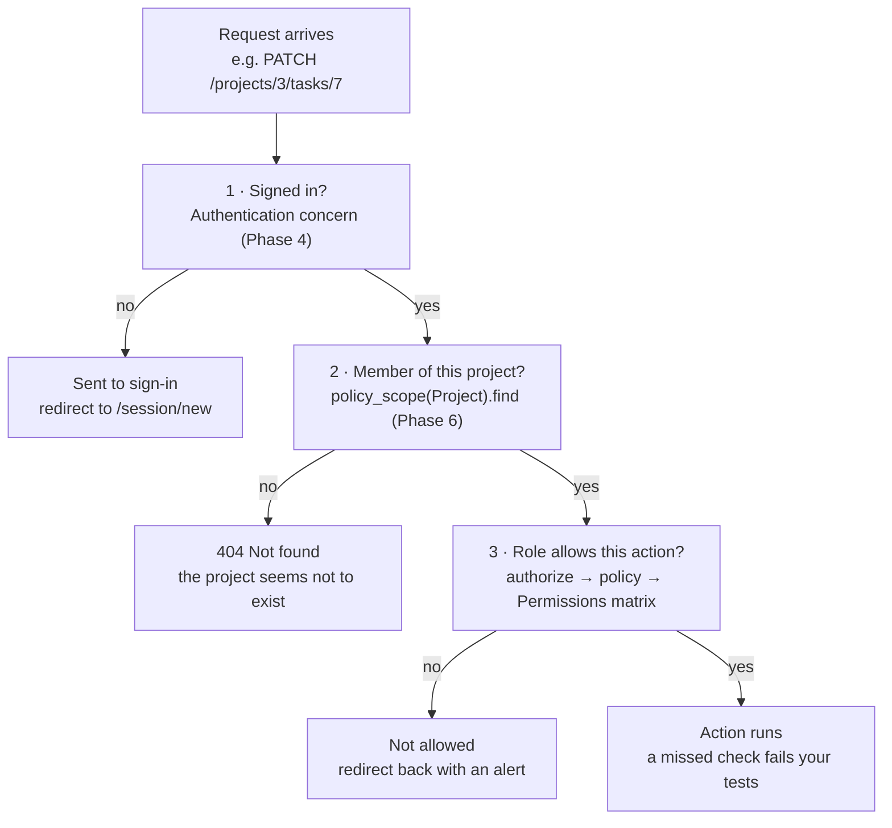

# Learn Ruby, Rails & GitHub: Build a Task Manager with RBAC

Oct 23, 2026 · @Andrew

## How to use this guide

In 20 working days (4 weeks of 5 × 6 hours) you will turn your [tasky](https://github.com/AndrewMosteika/tasky) repository into a Rails app on `http://localhost:3000`. People sign in, create projects, and what they can see and do in each project depends on their role **in that project**. Week 5 is optional polish.

**Where you are now:** tasky already has your RBAC matrix (`NOTES.md`), a deny-by-default `Authorizer` and `User` in `lib/`, and answers to three design questions. This guide keeps all of it: your matrix becomes the app's real permission table in Phase 6, and your third answer in hello.rb ("Will is an Admin on team B and a Viewer on team A") is why roles are stored per project.

The finished app has:

- Sign up, sign in and sign out
- Projects that hold tasks; each task has a title, description, status (to do, in progress, done), due date, creator and assignee
- Your four roles — **Viewer**, **Member**, **Admin**, **Owner** — held per project, so one person can be an Admin on one project and a Viewer on another
- A Members page where Admins and Owners add people and change roles, with guards so nobody can promote themselves
- Automated tests that prove every cell of your matrix
- All code on GitHub in tasky, built through branches and pull requests

**Versions this guide uses** (checked 23 Oct 2026): Ruby 4.0.9, Rails 8.1.4, Pundit 2.5.2, Brakeman 8.1.0. If a newer patch version exists when you start (for example Rails 8.1.5), use it; the steps do not change.

**Your daily loop (6 hours)**

1. **Read (1 h)** — the guide section for the day, plus the linked Rails Guide page.
2. **Build (3.5 h)** — type every command and every line of code yourself. Do not copy and paste. Typing is how the syntax sticks.
3. **Break it (30 min)** — change one thing on purpose and read the error. Errors are the main way Rails teaches you.
4. **Ship (30 min)** — commit, push, open a pull request, merge it (Phase 1 shows how).
5. **Notes (30 min)** — write 3 lines in `NOTES.md`: what I built, what confused me, one question. Bring the questions to Claude.

Each phase ends with a **Checkpoint**: a list of things you should be able to do without looking. If you cannot, repeat that part before moving on. When you get stuck for more than 30 minutes, stop and ask (Claude, a colleague, or the Rails forum) — paste the full error, the command you ran and the file you changed.

## Schedule

Day 1 sets up your Mac and Git, Days 2–3 are Ruby, and the app takes Days 4–20. RBAC gets 8 of those days because it's the part that must be right. The day numbers here are this guide's own; they restart at 1 and don't match the "Day 1–3 check" labels in your `hello.rb`. If you fall behind, cut Phase 8, never Phase 7.

| Day | Phase | Goal | Done when |
| --- | --- | --- | --- |
| 1 | 0 + 1 — Setup, Git | Morning: tools, GitHub, clone tasky, Ruby 4.0.9 for tasky only. Afternoon: first pull requests, a merge conflict | 3 PRs merged; `ruby -v` is 4.0.9 inside tasky and 3.4.11 outside |
| 2 | 2 — Ruby | Values, decisions, collections, blocks | Exercises 1–7 run |
| 3 | 2 — Ruby | Methods, classes, your first test, reading errors | `ruby practice/authorizer_test.rb` passes |
| 4 | 3 — Rails | `rails new`, time zone, folder tour, MVC, first page | Tasky runs on localhost:3000; GitHub checks pass |
| 5 | 3 — Rails | Project model, migrations, console | You create and query projects in `bin/rails console` |
| 6 | 3 — Rails | Projects: routes, controller, views by hand | Create, list, edit, delete projects in the browser |
| 7 | 3 — Rails | Task model belongs to a project | `project.tasks.create!(title: "x")` works in the console |
| 8 | 3 — Rails | Nested task pages, validations, status, due date | Tasks managed inside a project page; blank titles rejected |
| 9 | 3 — Rails | Model tests, debugging, review the week | `bin/rails test` is green |
| 10 | 4 — Auth | Authentication generator, sign in and out | Every page needs sign-in |
| 11 | 4 — Auth | Sign-up page; tasks record their creator | Two accounts each see their own email in the header |
| 12 | 5 — RBAC design | Final matrix, rules, threat list | `docs/rbac.md` merged |
| 13 | 6 — RBAC | Membership model, creator becomes Owner, port your Authorizer, demo people | `role_in` returns the right role for all 4 demo people |
| 14 | 6 — RBAC | Pundit, Project and Task policies, policy scopes | The Viewer gets "not allowed" editing a task; a non-member can't open the project |
| 15 | 6 — RBAC | Assignees and a "My tasks" page | An outsider can't be assigned; My tasks shows only your tasks |
| 16 | 6 — RBAC | Members page: add by email, change role, remove | The Admin can add a Viewer but can't create an Owner |
| 17 | 6 — RBAC | Last-owner guard, role-aware buttons | Each demo person sees only allowed buttons |
| 18 | 7 — Testing | Policy tests for every cell in the matrix | Every yes and no in the matrix has a test |
| 19 | 7 — Testing | Attack tests, Brakeman, GitHub rules | CI passes and `main` requires it |
| 20 | 7 — Review | README, self-review, demo | Someone else can clone and run it from the README |
| 21–25 | 8 — Stretch (optional) | Audit log, invitations, filters, styling | Your choice |

## Phase 0 — Set up your Mac (Day 1, morning)

By lunchtime on Day 1, Git and GitHub are connected, tasky is on your Mac, and the tasky folder runs Ruby 4.0.9 and Rails 8.1.4. Your other project keeps Ruby 3.4.11. I checked your Mac: Homebrew, mise, the GitHub CLI (`gh`) and Ruby 3.4.11 are already installed, so several steps below just confirm what's there.

**Words you'll meet today**

- **Terminal** — the text window where you type commands. Open it with Cmd+Space, type "Terminal".
- **Homebrew** (`brew`) — installs Mac software from the terminal.
- **mise** — a version manager: lets each folder use its own Ruby version.
- **Gem** — a Ruby library. **Rails** is a gem. **Bundler** installs the gems a project lists in its `Gemfile`.

### 1. Learn five terminal commands (30 min)

```bash
pwd            # where am I?
ls -la         # what's in this folder?
mkdir ~/code   # make a folder called code in your home folder
cd ~/code      # move into it
cd ..          # go up one folder
```

Keep all projects in `~/code`. When one terminal tab is busy (for example running the Rails server), open another with Cmd+T and `cd` back into your project there.

### 2. Check Homebrew and install build tools (20 min)

```bash
brew --version
brew update
brew install openssl@3 libyaml gmp
```

Ruby needs these libraries to install. If `brew --version` fails, install Homebrew from [brew.sh](https://brew.sh) first.

### 3. Configure Git (15 min)

```bash
git config --global user.name "Your Name"
git config --global user.email "you@example.com"
git config --global init.defaultBranch main
git config --global pull.rebase false
git config --global --list
```

Use the same email as your GitHub account so your commits link to your profile.

### 4. Connect to GitHub (45 min)

1. Sign in at [github.com](https://github.com).
2. In the terminal run `gh auth login` and answer: **GitHub.com** → **SSH** → **Generate a new SSH key: Yes** → set a passphrase → **Login with a web browser**.
3. Test it: `ssh -T git@github.com` should reply "Hi *your-username*! You've successfully authenticated".

An **SSH key** is a pair of files: a private key that stays on your Mac (never share it) and a public key that GitHub stores. Together they prove it's you without typing a password.

### 5. Get tasky onto your Mac (10 min)

```bash
cd ~/code
git clone git@github.com:AndrewMosteika/tasky.git
cd tasky
git remote -v              # should show github.com:AndrewMosteika/tasky
git log --oneline          # one line per commit
```

If you already have a copy somewhere else, `cd` into it and run `git pull` instead of cloning.

### 6. Install Ruby 4.0.9 for tasky only (40 min)

Your other project needs Ruby 3.4.11, so don't change your global Ruby. mise can give **one folder** its own version:

```bash
cd ~/code/tasky
mise use ruby@4.0.9      # installs 4.0.9 and writes mise.toml in this folder only
ruby -v                  # ruby 4.0.9 — inside tasky
cd ~ && ruby -v          # ruby 3.4.11 — everywhere else
cd ~/code/tasky
```

Switching is automatic: mise reads `mise.toml` whenever you `cd` into the folder. You'll commit `mise.toml` in this afternoon's first pull request. Gems belong to one Ruby version, so the Rails you install next exists only inside tasky, and your other project's gems aren't touched.

Your shell also loads **rbenv**, a second version manager. If `ruby -v` inside tasky doesn't print 4.0.9 in a new terminal window, tell me before changing anything, since your other project may rely on that setup.

### 7. Install Rails (15 min)

```bash
cd ~/code/tasky         # Rails must be installed under tasky's Ruby
gem install rails -v 8.1.4
rails -v                # Rails 8.1.4
```

### 8. Install an editor (30 min)

```bash
brew install --cask visual-studio-code
```

Open VS Code, then install the **Ruby LSP** extension (by Shopify). It gives autocomplete, error highlights and formatting. Press Cmd+Shift+P, run **Shell Command: Install 'code' command in PATH**, and from then on `code .` opens the current folder.

### Checkpoint

- [ ] `ruby -v` prints 4.0.9 inside tasky and 3.4.11 outside it
- [ ] `rails -v` prints 8.1.4 inside tasky
- [ ] `ssh -T git@github.com` greets you by username
- [ ] `code .` opens VS Code
- [ ] You can explain what a gem and a version manager are

## Phase 1 — Git and GitHub (Day 1, afternoon)

From now on, every piece of work follows one loop: branch → commit → push → pull request → merge. So far your tasky commits have gone straight to `main`; this afternoon you make your first three pull requests.

**Git vs GitHub:** Git is the tool on your Mac that records snapshots (commits) of your files. GitHub is a website that stores a copy of your repository and adds pull requests, reviews and automated checks.

### 1. Your first pull request: move the practice files (45 min)

Rails creates its own `lib/` folder and loads every file in it automatically. Left where it is, your `lib/user.rb` would clash with the real `User` model Rails builds on Day 10. Move the practice code into `practice/`, and commit this morning's `mise.toml` with it:

```bash
cd ~/code/tasky
git switch -c move-practice-files
mkdir practice
git mv hello.rb try.rb lib practice/
ruby practice/try.rb       # still works: lib/ moved with try.rb
git add mise.toml
git status                 # renamed files, plus the new mise.toml
git commit -m "Move practice files into practice/ and pin Ruby 4.0.9"
git push -u origin move-practice-files
gh pr create --fill        # open a pull request
gh pr view --web           # read your own diff on GitHub
gh pr merge --squash --delete-branch
git switch main
git pull                   # bring the merged change back to your Mac
```

- `git mv` tells Git the file was renamed, so its history follows it.
- **Staging** (`git add`) picks which changes go into the next commit; **committing** saves them with a message.
- A **pull request** (PR) is a proposal to merge a branch into `main`. Even working alone, read your own diff on GitHub before merging — you'll catch mistakes there that you missed in the editor.
- `--squash` turns the branch into one tidy commit on `main`.

Run `git status` before and after each command until you can predict what it will say.

### 2. The loop on your own (45 min)

Do it again for a real change: replace the README's single line with two sentences about what Tasky is.

```bash
git switch main && git pull
git switch -c readme-intro
code README.md             # edit and save
git diff                   # review what changed
git add README.md
git commit -m "Describe Tasky in the README"
git push -u origin readme-intro
gh pr create --fill
gh pr merge --squash --delete-branch
git switch main && git pull
```

**Good commit messages** say what the change does, in the imperative, under 72 characters: "Add due date to tasks", not "stuff" or "fixed it".

### 3. Cause and fix a merge conflict, on purpose (1 h)

1. `git switch -c conflict-a`, change line 1 of `practice/hello.rb`, commit, push, and merge it with a PR as above. Then `git switch main && git pull`.
2. `git switch -c conflict-b main~1` — a branch starting from `main` as it was **before** conflict-a.
3. Change line 1 of `practice/hello.rb` differently and commit. Then run `git merge main`. Git stops and marks the clash with `<<<<<<<`, `=======` and `>>>>>>>`.
4. Edit the file to keep what you want, delete the markers, then `git add practice/hello.rb` and `git commit`. Push and merge the PR.

### 4. Undo mistakes (20 min)

| Situation | Command |
| --- | --- |
| You changed a file and want the last committed version back | `git restore <file>` |
| You staged a file by mistake | `git restore --staged <file>` |
| A bad commit is already on `main` | `git revert <commit-id>` — adds a new commit that undoes it |
| You have uncommitted work on the wrong branch | `git stash`, `git switch <right-branch>`, `git stash pop` |

Try each one once in `practice/` so you've seen them before you need them.

### Rules for this project

- Never commit directly to `main`. Start every day with `git switch main && git pull && git switch -c <short-name>`.
- One branch = one small feature, under about 200 changed lines (Day 4's `rails new` is the one exception).
- From Day 4, run `bin/rails test` and `bin/rubocop -a` before every pull request. GitHub runs the same checks.
- tasky is public, so never commit passwords or keys. Rails keeps secrets in `config/master.key`, which its `.gitignore` already excludes — check it stays that way.
- If `main` has moved on, run `git merge main` on your branch before opening the PR.

### Checkpoint

- [ ] tasky has at least 3 merged pull requests
- [ ] You resolved a merge conflict by hand
- [ ] You can explain staging, committing, pushing and a pull request in one sentence each

## Phase 2 — Ruby fundamentals (Days 2–3)

You only need about 20% of Ruby to build a Rails app, and these two days cover it; the Rails days keep you practising. Your `hello.rb` and `Authorizer` show you've met some of this already: skim what you know, but do every exercise. Save exercises in `practice/` and finish each day with a pull request.

**Two ways to run Ruby** (always from inside `~/code/tasky`, so you get Ruby 4.0.9)

- `irb` — an interactive prompt. Type a line, see the result. Type `exit` to leave. Use it to try things.
- `ruby practice/file.rb` — runs a file top to bottom. Use it for exercises.

**Reading:** [Ruby in Twenty Minutes](https://www.ruby-lang.org/en/documentation/quickstart/) on Day 2, then the matching chapters of Chris Pine's free [Learn to Program](https://pine.fm/LearnToProgram/).

### Day 2 (morning) — Values and decisions

```ruby
name = "Ada"                  # a String
age = 36                      # an Integer
done = false                  # a Boolean
puts "Hello, #{name}!"        # #{} puts a value inside a string
puts age + 1                  # 37

if age >= 18
  puts "adult"
elsif age >= 13
  puts "teen"
else
  puts "child"
end

puts "not done yet" unless done
status = done ? "finished" : "open"   # short if/else
```

`nil` means "nothing". In Ruby only `nil` and `false` count as false; `0` and `""` count as true.

**Exercise 1** — `greet.rb`: store your name and the year you were born; print "Hi Sam, you are about 30".

**Exercise 2** — `grade.rb`: given `score = 72`, print A (90+), B (70–89), C (50–69) or F.

**Exercise 3** — `fizzbuzz.rb`: print 1 to 30, but "Fizz" for multiples of 3, "Buzz" for 5, "FizzBuzz" for both. Hint: `(1..30).each do |n| ... end` and `n % 3 == 0`.

### Day 2 (afternoon) — Collections and blocks

```ruby
tasks = ["Buy milk", "Write report", "Call Sam"]   # an Array
tasks << "Book dentist"                             # add to the end
puts tasks.first
puts tasks.length

task = { title: "Buy milk", status: :todo }          # a Hash (key => value)
puts task[:title]
task[:status] = :done

# A block is the code between do...end (or { }). Methods run it for you.
tasks.each { |t| puts "- #{t}" }
upper = tasks.map { |t| t.upcase }                   # transform each item
long = tasks.select { |t| t.length > 8 }             # keep matching items
```

`:todo` is a **symbol** — a lightweight fixed name. Rails uses them everywhere for keys and options.

**Exercise 4** — `list.rb`: make an array of 5 task hashes with `:title` and `:status` (`:todo` or `:done`). Print only the titles of tasks still to do.

**Exercise 5** — add a count: "2 of 5 tasks done". Use `count { |t| ... }`.

**Exercise 6** — `keys.rb`: `roles = { "admin" => 3, viewer: 0 }`. Print `roles["admin"]`, `roles[:admin]`, `roles[:viewer]` and `roles["viewer"]`. Two print nothing (`nil`) — work out why, then fix them with `.to_s` and `.to_sym`. String keys and symbol keys are different keys; this matters on Day 13.

**Exercise 7** — `word_count.rb`: count how often each word appears in a sentence. Use `split`, a hash made with `Hash.new(0)` (every new key starts at 0), and `sort_by` to print the top 3.

### Day 3 (morning) — Methods and classes

```ruby
def shout(text)
  text.upcase + "!"           # the last line is returned automatically
end

class Task
  attr_reader :title, :status  # creates title and status reader methods

  def initialize(title)        # runs when you call Task.new
    @title = title             # @ = instance variable, kept by this object
    @status = :todo
  end

  def complete!
    @status = :done
  end

  def done?
    status == :done
  end
end

t = Task.new("Buy milk")
t.complete!
puts t.done?                 # true
```

Naming habits: methods ending in `?` return true/false; methods ending in `!` change something. A **class** is a blueprint; an **object** (or instance) is one thing built from it.

**Exercise 8** — `task_list.rb`: build the `Task` class above plus a `TaskList` class with `add(task)`, `pending` (tasks not done) and `summary` ("1 of 3 done"). This is, in miniature, what Rails will do for you with a database.

**Exercise 9 — tidy your Authorizer.** In `practice/lib/`, delete the stray `21` on the last line of `authorizer.rb` (Ruby runs it and quietly ignores it), and re-indent `user.rb` with 2 spaces — the Ruby convention.

### Day 3 (afternoon) — Your first test, and Ruby you'll see in Rails

**Exercise 10 — your first test.** A test is code that checks other code. Ruby ships with **Minitest**, and Rails uses it too. Create `practice/authorizer_test.rb`:

```ruby
require "minitest/autorun"
require_relative "lib/user"
require_relative "lib/authorizer"

class AuthorizerTest < Minitest::Test
  def setup
    @authorizer = Authorizer.new
  end

  def test_viewer_cannot_delete_tasks
    vera = User.new("Vera", :viewer)
    refute @authorizer.can?(vera, :delete, :task)
  end

  def test_unknown_role_is_denied
    ghost = User.new("Ghost", :wizard)
    refute @authorizer.can?(ghost, :read, :task)
  end
end
```

Run it with `ruby practice/authorizer_test.rb`. Add 4 tests of your own: two things that should be allowed (`assert`) and two that should be denied (`refute`). Then break `can?` on purpose (make it always return `true`) and watch the tests catch it.

**Ruby you'll see in Rails.** You'll meet these in the next two weeks; try each in `irb` now.

| You'll see | It means |
| --- | --- |
| `%w[a b]` and `%i[a b]` | `["a", "b"]` and `[:a, :b]` |
| `user&.name` | `user.name`, or `nil` instead of a crash if `user` is `nil` |
| `class Task < ApplicationRecord` | `Task` inherits everything `ApplicationRecord` can do |
| `private` | methods below it can only be called from inside the class |
| `module Permissions` with `def self.allows?` | a container for methods you call directly: `Permissions.allows?(...)` |
| `-> { ... }` | a lambda: a block saved to run later |
| `MATRIX = { ... }.freeze` | a constant that can't be changed |
| `def done? = status == :done` | a method written on one line |
| `task.public_send(:done?)` | calls a method whose name is in a variable |

**Exercise 11** — rewrite `TaskList#pending` with `reject`, and add a one-line `def empty? = ...`.

**Reading errors.** Misspell a method in `task_list.rb` (`t.titel`) and run it. The first line of the error says **what** went wrong (`undefined method 'titel'`); the next lines say **where** (`task_list.rb:14`). Read the first line, then find the first line that names your own file. Every Rails error you meet works the same way.

### Checkpoint

- [ ] You can explain the difference between an array and a hash, and between `"admin"` and `:admin` as keys
- [ ] You can write a class with `initialize`, an instance variable and two methods
- [ ] `ruby practice/authorizer_test.rb` passes, and fails when you break `can?`
- [ ] You can read `tasks.select { |t| t[:status] == :todo }` aloud in plain English

## Phase 3 — Your first Rails app (Days 4–9)

By Day 9 tasky is a working Rails app where you can manage projects and their tasks in the browser. There are no users or roles yet; those come in Phases 4 and 6. Each day is one branch and one pull request: start with `git switch main && git pull && git switch -c <short-name>`, and finish with `bin/rails test`, `bin/rubocop -a`, commit, push, PR, merge.

**How a Rails request works (MVC)**

1. Your browser asks for `/projects/3`.
2. The **router** (`config/routes.rb`) maps that URL to a controller action: `ProjectsController#show`.
3. The **controller** asks the **model** for data: `Project.find(3)`.
4. The **model** (`app/models/project.rb`) reads row 3 from the database table `projects`.
5. The controller hands the data to a **view** (`app/views/projects/show.html.erb`), which turns it into HTML.
6. Rails sends the HTML back to the browser.

Read [Getting Started with Rails](https://guides.rubyonrails.org/getting_started.html) alongside this phase. It builds a different app, but the ideas are the same.

### Day 4 — Generate the app

```bash
cd ~/code/tasky
git switch main && git pull
git switch -c rails-new
rails new . --skip-kamal --skip-thruster --skip-system-test
```

The `.` means "build it in this folder". The three `--skip` options leave out deployment tools and browser-driven tests you don't need on localhost (without the last one, GitHub's checks fail from day one). Rails asks `Overwrite README.md?` and `Overwrite .gitignore?`: answer **Y** to both. Your `NOTES.md`, `mise.toml` and `practice/` are left alone. Rails also writes a `.ruby-version` file; mise on your Mac ignores it, and `mise.toml` stays in charge.

Then:

```bash
echo ".DS_Store" >> .gitignore
```

Set the app's time zone so due dates and timestamps show your local time. In `config/application.rb`, inside `class Application`, add `config.time_zone = "London"` (run `bin/rails time:zones` to see the names if you're elsewhere).

Start the server in a **second terminal tab** (Cmd+T, then `cd ~/code/tasky`), because it keeps running:

```bash
bin/rails server            # open http://localhost:3000, Ctrl+C to stop
```

**Folder tour** — open each in VS Code and read the comments:

| Path | What lives there |
| --- | --- |
| `app/models/` | Ruby classes for your data (Project, Task, User) |
| `app/controllers/` | Code that handles each request |
| `app/views/` | HTML templates. `<% %>` runs Ruby; `<%= %>` runs it and prints the result |
| `config/routes.rb` | Which URL goes to which controller action |
| `db/migrate/` | Step-by-step changes to the database structure |
| `db/schema.rb` | The current database structure (generated — never edit by hand) |
| `test/` | Automated tests |
| `Gemfile` | The gems this app uses |
| `.github/workflows/ci.yml` | **CI** (continuous integration): checks GitHub runs on every pull request — tests, Brakeman, code style |

**First page:** `bin/rails generate controller Pages home`, then in `config/routes.rb` add `root "pages#home"` and put `<h1>Tasky</h1>` in `app/views/pages/home.html.erb`.

Before the PR, run `bin/rubocop -a`. **RuboCop** checks code style and fixes what it can; it will also tidy your `practice/` files to the Rails style. This PR is large because it's the whole generated app — that's fine once.

### Day 5 — The Project model

```bash
bin/rails generate model Project name:string description:text
bin/rails db:migrate
```

Open the new file in `db/migrate/` — it says "create a table called projects with these columns". `db:migrate` runs it against the SQLite database in `storage/`. Add a rule to `app/models/project.rb`:

```ruby
class Project < ApplicationRecord
  validates :name, presence: true
end
```

Now play in the console (`bin/rails console`):

```ruby
Project.create!(name: "Website relaunch")
Project.create(name: "")          # returns an unsaved project
Project.new(name: "").valid?       # false
Project.count
project = Project.first
project.update!(description: "Q4 work")
Project.where("name LIKE ?", "%Web%")
Project.create!(name: "Throwaway").destroy
```

### Day 6 — Project pages, by hand

Rails can generate all of this with `scaffold`, but writing it once by hand is how you learn what each piece does. In `config/routes.rb`:

```ruby
resources :projects
```

Run `bin/rails routes -g project` to see the 8 URLs that one line creates. Create `app/controllers/projects_controller.rb`:

```ruby
class ProjectsController < ApplicationController
  before_action :set_project, only: %i[show edit update destroy]

  def index
    @projects = Project.order(:name)
  end

  def show
  end

  def new
    @project = Project.new
  end

  def create
    @project = Project.new(project_params)
    if @project.save
      redirect_to @project, notice: "Project created."
    else
      render :new, status: :unprocessable_content
    end
  end

  def edit
  end

  def update
    if @project.update(project_params)
      redirect_to @project, notice: "Project updated."
    else
      render :edit, status: :unprocessable_content
    end
  end

  def destroy
    @project.destroy
    redirect_to projects_path, notice: "Project deleted.", status: :see_other
  end

  private

  def set_project
    @project = Project.find(params[:id])
  end

  def project_params
    params.expect(project: [ :name, :description ])
  end
end
```

- `before_action` runs `set_project` before the listed actions, so each one has `@project` ready.
- `project_params` is a **strong parameters** allow-list: only `name` and `description` are accepted from the form. Anything else someone adds to the request is dropped.
- The spaces inside `[ ... ]` are the Rails code style; RuboCop expects them.

Then the views in `app/views/projects/`. `_form.html.erb` (the `_` means a **partial**, shared by new and edit):

```erb
<%= form_with model: project do |form| %>
  <% if project.errors.any? %>
    <ul>
      <% project.errors.full_messages.each do |message| %>
        <li><%= message %></li>
      <% end %>
    </ul>
  <% end %>

  <div>
    <%= form.label :name %>
    <%= form.text_field :name %>
  </div>
  <div>
    <%= form.label :description %>
    <%= form.text_area :description %>
  </div>
  <%= form.submit %>
<% end %>
```

`new.html.erb` is `<h1>New project</h1>` plus `<%= render "form", project: @project %>`; `edit.html.erb` is the same with "Edit project". `index.html.erb`:

```erb
<h1>Projects</h1>
<%= link_to "New project", new_project_path %>
<ul>
  <% @projects.each do |project| %>
    <li><%= link_to project.name, project %></li>
  <% end %>
</ul>
```

`show.html.erb`:

```erb
<h1><%= @project.name %></h1>
<p><%= @project.description %></p>
<%= link_to "Edit", edit_project_path(@project) %>
<%= button_to "Delete", @project, method: :delete,
      form: { data: { turbo_confirm: "Delete this project?" } } %>
```

`turbo_confirm` shows a "Are you sure?" box before deleting. Show flash messages on every page: in `app/views/layouts/application.html.erb`, just above `<%= yield %>`, add `<p><%= notice %></p>` and `<p><%= alert %></p>`. Point `root` at `"projects#index"`, then remove the Pages controller and everything that came with it:

```bash
bin/rails destroy controller Pages home
```

### Day 7 — Tasks belong to a project

```bash
bin/rails generate model Task project:references title:string description:text status:integer due_on:date
```

Before migrating, open the migration and change the status line to `t.integer :status, default: 0, null: false` so every task starts as "to do". Then `bin/rails db:migrate` and edit the models:

```ruby
class Project < ApplicationRecord
  has_many :tasks, dependent: :destroy
  validates :name, presence: true
end

class Task < ApplicationRecord
  belongs_to :project
  enum :status, { todo: 0, in_progress: 1, done: 2 }
  validates :title, presence: true
end
```

`has_many` / `belongs_to` are **associations**; `enum` turns the number in the database into readable names. In the console:

```ruby
project = Project.first
task = project.tasks.create!(title: "Draft copy")
task.in_progress!
task.done?
Task.done.count
project.tasks.order(:due_on)
```

### Day 8 — Task pages inside a project

Nest the routes so every task URL contains its project (`/projects/3/tasks/7`):

```ruby
resources :projects do
  resources :tasks, except: :index
end
```

Try writing `app/controllers/tasks_controller.rb` yourself from `ProjectsController`, then compare with this. The important difference: tasks are always found **through their project**.

```ruby
class TasksController < ApplicationController
  before_action :set_project
  before_action :set_task, only: %i[show edit update destroy]

  def show
  end

  def new
    @task = @project.tasks.new
  end

  def create
    @task = @project.tasks.new(task_params)
    if @task.save
      redirect_to @project, notice: "Task added."
    else
      render :new, status: :unprocessable_content
    end
  end

  def edit
  end

  def update
    if @task.update(task_params)
      redirect_to @project, notice: "Task updated."
    else
      render :edit, status: :unprocessable_content
    end
  end

  def destroy
    @task.destroy
    redirect_to @project, notice: "Task deleted.", status: :see_other
  end

  private

  def set_project
    @project = Project.find(params[:project_id])
  end

  def set_task
    @task = @project.tasks.find(params[:id])
  end

  def task_params
    params.expect(task: [ :title, :description, :status, :due_on ])
  end
end
```

`@project.tasks.find` means someone who changes the URL to `/projects/3/tasks/99` gets "not found" if task 99 belongs to another project. Finding records through their parent is the first habit of authorisation.

Views in `app/views/tasks/`. `_form.html.erb`:

```erb
<%= form_with model: [ project, task ] do |form| %>
  <% if task.errors.any? %>
    <ul>
      <% task.errors.full_messages.each do |message| %>
        <li><%= message %></li>
      <% end %>
    </ul>
  <% end %>

  <div>
    <%= form.label :title %>
    <%= form.text_field :title %>
  </div>
  <div>
    <%= form.label :description %>
    <%= form.text_area :description %>
  </div>
  <div>
    <%= form.label :status %>
    <%= form.select :status, Task.statuses.keys.map { |s| [ s.humanize, s ] } %>
  </div>
  <div>
    <%= form.label :due_on, "Due date" %>
    <%= form.date_field :due_on %>
  </div>
  <%= form.submit %>
<% end %>
```

`form.date_field` uses the browser's own date picker — no gem needed. `new.html.erb` is `<h1>New task</h1>` plus `<%= render "form", project: @project, task: @task %>`; `edit.html.erb` is the same with "Edit task". `show.html.erb`:

```erb
<h1><%= @task.title %></h1>
<p><%= @task.description %></p>
<p>Status: <%= @task.status.humanize %> · Due: <%= @task.due_on || "no date" %></p>
<%= link_to "Edit", edit_project_task_path(@project, @task) %>
<%= button_to "Delete", [ @project, @task ], method: :delete,
      form: { data: { turbo_confirm: "Delete this task?" } } %>
<%= link_to "Back to #{@project.name}", @project %>
```

Finally list the tasks on the project's page — add to `app/views/projects/show.html.erb`:

```erb
<h2>Tasks</h2>
<%= link_to "New task", new_project_task_path(@project) %>
<ul>
  <% @project.tasks.order(:due_on).each do |task| %>
    <li>
      <%= link_to task.title, [ @project, task ] %>
      — <%= task.status.humanize %>, due <%= task.due_on || "no date" %>
    </li>
  <% end %>
</ul>
```

Nested routes give nested helpers: `new_project_task_path(@project)`, `edit_project_task_path(@project, task)`, and `[ @project, task ]` wherever Rails accepts a record.

### Day 9 — First Rails tests, debugging, and review

The generator created `test/models/task_test.rb` and sample data in `test/fixtures/` (**fixtures** are test records written in YAML). Add:

```ruby
require "test_helper"

class TaskTest < ActiveSupport::TestCase
  test "needs a title" do
    task = Task.new(project: projects(:one))
    assert_not task.valid?
    assert_includes task.errors[:title], "can't be blank"
  end

  test "starts as to do" do
    assert Task.new.todo?
  end
end
```

Run `bin/rails test`. Write the same kind of test for Project's name.

**Debugging, three ways** — try each once today:

1. **Read the server log.** The server tab prints every request: the URL, the controller action, the SQL it ran and the response code. Most bugs are visible there.
2. **Pause the code.** Put `binding.irb` on a line in `TasksController#create`, submit the form, and the server tab turns into an `irb` prompt at that exact moment. Type `params` or `@task.errors`, then `exit` to carry on. Remove the line afterwards.
3. **Check data in the console.** `bin/rails console`, then `Task.last` — did it save what you expected?

Spend the rest of the day re-reading this week's code and writing in `NOTES.md` anything you can't yet explain.

### Checkpoint

- [ ] You can trace a request from URL to route, controller, model and view, naming the file for each
- [ ] You can add a column with a migration and explain what `db/schema.rb` is
- [ ] You can explain why `@project.tasks.find(id)` is safer than `Task.find(id)`
- [ ] `bin/rails test` is green and GitHub's checks pass on your pull requests

## Phase 4 — Users and sign-in (Days 10–11)

By Day 11 every page needs sign-in, people can create their own accounts, and each task records who created it. This is **authentication** (who are you?), not yet authorisation (what may you do?) — exactly the distinction you wrote down in `hello.rb`.

### Day 10 — The authentication generator

Rails 8 ships a generator that writes a secure, readable sign-in system into your app. You own the code it creates, so read every file.

```bash
bin/rails generate authentication
bin/rails db:migrate
```

What it creates:

| File | Job |
| --- | --- |
| `app/models/user.rb` | `has_secure_password` stores a **bcrypt hash** of the password, never the password itself |
| `app/models/session.rb` | One row per signed-in browser; the cookie holds a signed session id |
| `app/models/current.rb` | `Current.user` — the signed-in user, available anywhere during a request |
| `app/controllers/concerns/authentication.rb` | A **concern** (a module shared by controllers) that makes **every** page require sign-in unless the controller says `allow_unauthenticated_access` |
| `app/controllers/sessions_controller.rb` | Sign in (`/session/new`) and sign out, rate-limited against password guessing |
| `app/controllers/passwords_controller.rb` | Password reset by email |
| `test/test_helpers/session_test_helper.rb` | `sign_in_as(user)` for tests — you'll use it on Day 19 |

Create yourself in the console, then sign in at `http://localhost:3000/session/new`:

```ruby
User.create!(email_address: "you@example.com", password: "correct-horse-battery")
```

In the layout, show who's signed in and a sign-out button:

```erb
<% if authenticated? %>
  <%= Current.user.email_address %>
  <%= button_to "Sign out", session_path, method: :delete %>
<% end %>
```

**Break it:** open a private browser window and visit `/projects` — you should be sent to the sign-in page. Then look in the database (`bin/rails dbconsole`, then `select password_digest from users;`, then `.quit`) and confirm the password isn't stored in plain text.

### Day 11 — Sign-up, and tasks know their creator

The generator doesn't include sign-up, so you'll write it. In `config/routes.rb` add `resource :registration, only: %i[new create]`, then create `app/controllers/registrations_controller.rb`:

```ruby
class RegistrationsController < ApplicationController
  allow_unauthenticated_access
  rate_limit to: 10, within: 3.minutes, only: :create,
    with: -> { redirect_to new_registration_path, alert: "Try again later." }

  def new
    @user = User.new
  end

  def create
    @user = User.new(user_params)
    if @user.save
      start_new_session_for @user
      redirect_to root_path, notice: "Welcome to Tasky!"
    else
      render :new, status: :unprocessable_content
    end
  end

  private

  def user_params
    params.expect(user: [ :email_address, :password, :password_confirmation ])
  end
end
```

Add rules to `app/models/user.rb`:

```ruby
validates :email_address, presence: true, uniqueness: true
validates :password, length: { minimum: 12 }, allow_nil: true
```

The new 12-character minimum breaks one generated test: in `test/controllers/passwords_controller_test.rb`, the update test sets the password to `"new"`. Change both of its `"new"` values to `"new-password-123"`.

`app/views/registrations/new.html.erb`:

```erb
<h1>Create an account</h1>
<%= form_with model: @user, url: registration_path do |form| %>
  <% if @user.errors.any? %>
    <ul>
      <% @user.errors.full_messages.each do |message| %>
        <li><%= message %></li>
      <% end %>
    </ul>
  <% end %>

  <div>
    <%= form.label :email_address %>
    <%= form.email_field :email_address, required: true, autocomplete: "username" %>
  </div>
  <div>
    <%= form.label :password %>
    <%= form.password_field :password, required: true, autocomplete: "new-password" %>
  </div>
  <div>
    <%= form.label :password_confirmation %>
    <%= form.password_field :password_confirmation, required: true, autocomplete: "new-password" %>
  </div>
  <%= form.submit "Create account" %>
<% end %>
```

Link to it from the sign-in page: in `app/views/sessions/new.html.erb` add `<%= link_to "Create an account", new_registration_path %>`.

**Now record who created each task.** Existing tasks have no creator, so the database has to be emptied and rebuilt. This deletes everything in your local database, including your Day 10 account (your code is untouched).

1. `bin/rails generate migration AddCreatorToTasks`
2. In the new migration's `change` method: `add_reference :tasks, :creator, null: false, foreign_key: { to_table: :users }`
3. `bin/rails db:migrate:reset` — empties the database and runs every migration again.
4. Sign up again through your new sign-up page.

In `Task` add `belongs_to :creator, class_name: "User"`; in `TasksController#create` add `@task.creator = Current.user` before `if @task.save`. **Never** put `creator_id` in `task_params`: anything allowed there can be faked from the browser. Add `creator: one` to each task in `test/fixtures/tasks.yml`, then check `bin/rails test` is green.

### Checkpoint

- [ ] Signed-out visitors can reach only sign-in, sign-up and password reset
- [ ] You can explain why the database stores `password_digest` and not `password`
- [ ] Two accounts you created each see their own email in the header
- [ ] You can explain why `creator_id` is set in the controller and not taken from the form

## Phase 5 — RBAC design (Day 12)

Today you write no app code. You finish the design on paper so Phase 6 is just typing it in. The core decision is made: a role belongs to a **membership** (one user + one project + one role), not to the user.

### The final permission matrix

This is your `NOTES.md` matrix with two changes:

1. **Creating a project moves outside the matrix.** Creating a project doesn't happen *inside* a project, so no project role can grant it. Rule: any signed-in user can create a project and becomes its Owner.
2. **A Members column is added.** Someone has to add people and set roles, and that power needs limits.

| Role (in this project) | Project | Task | Members |
| --- | --- | --- | --- |
| Viewer | read | read | read |
| Member | read | read, create, update | read |
| Admin | read, update | read, create, update, delete | read; manage Viewers and Members |
| Owner | read, update, delete | read, create, update, delete | read; manage everyone |
| Not a member | nothing (the project looks like it doesn't exist) | nothing | nothing |

### Rules the matrix can't express

1. **Deny by default.** Unknown role, unknown action or no membership means no — your second answer in `hello.rb`.
2. **No self-promotion.** An Admin can only add, change or remove Viewers and Members, and can only give those two roles. Only an Owner can create or change an Admin or Owner.
3. **Every project keeps at least one Owner.** The last Owner can't leave or be demoted.
4. **Non-members get 404, not 403.** "Not authorised" would confirm the project exists.
5. **Assignees must be members** of the task's project.
6. **The server decides.** Every action is checked in the controller before it changes anything. Hiding a button is a convenience, never a defence.
7. **Forgetting a check is an error.** If an action never asks a policy, Pundit raises an error, so the forgotten check fails your tests. It's a tripwire for mistakes, not the defence itself — the defence is rule 6.

### Where each check lives

**Every request passes three checks before anything changes**



A no at any check stops the request before anything changes. Hiding buttons (Day 17) only changes what people see; these three checks are what protect the data.

### Data model

| Model | Columns | Associations |
| --- | --- | --- |
| User | `email_address`, `password_digest` | has many memberships; has many projects through memberships |
| Membership | `user_id`, `project_id`, `role` (viewer 0, member 1, admin 2, owner 3) | belongs to user and project; one per user per project (unique index) |
| Project | `name`, `description` | has many memberships, users (through memberships) and tasks |
| Task | `project_id`, `title`, `description`, `status`, `due_on`, `creator_id`, `assignee_id` | belongs to project and creator (User); optionally to assignee (User) |

### Threat list

Think like an attacker. Each row becomes at least one test in Phase 7.

| Attack | Defence |
| --- | --- |
| A Viewer sends an edit request directly, skipping the hidden button | Pundit `authorize` in every controller action |
| A non-member types `/projects/5` | Projects are only ever found through your memberships, so this returns 404 |
| A task is reached through the wrong project: `/projects/1/tasks/9` when task 9 is in project 2 | Tasks are only found through their project: `@project.tasks.find` |
| An Admin promotes themselves or a friend to Owner | `MembershipPolicy`: Admins only touch Viewer and Member memberships |
| Sign-up form sent with an extra `role=owner` field | Users have no role column, and strong parameters drop unknown fields |
| The last Owner leaves or is demoted, orphaning the project | A validation and a `before_destroy` check on `Membership` |
| A task is assigned to someone outside the project | Validation on `Task` |
| A new controller action forgets to check permissions | `verify_pundit_authorization` raises an error, so the tests fail |

**Deliverable:** move the matrix from `NOTES.md` into `docs/rbac.md` with the rules and threat list above, in your own words, and merge it as a PR. When the code and this file disagree later, one of them is a bug.

## Phase 6 — RBAC implementation (Days 13–17)

By Day 17 every rule in `docs/rbac.md` is enforced. Your `Authorizer` becomes the app's permission table, and the **Pundit** gem connects it to every controller. Pundit is small: each **policy** is a plain Ruby class with methods like `update?` that return true or false — the same idea as your `can?`.

### Day 13 — Memberships, your Authorizer, and demo people

```bash
bin/rails generate model Membership user:references project:references role:integer
```

In the migration, make the role required and stop anyone joining the same project twice:

```ruby
create_table :memberships do |t|
  t.references :user, null: false, foreign_key: true
  t.references :project, null: false, foreign_key: true
  t.integer :role, null: false, default: 0
  t.timestamps
  t.index [ :user_id, :project_id ], unique: true
end
```

The models:

```ruby
class Membership < ApplicationRecord
  belongs_to :user
  belongs_to :project

  enum :role, { viewer: 0, member: 1, admin: 2, owner: 3 }, validate: true

  validates :user_id, uniqueness: { scope: :project_id }
end

class User < ApplicationRecord
  # ...generated code stays...
  has_many :memberships, dependent: :destroy
  has_many :projects, through: :memberships

  # "owner", "admin", "member", "viewer", or nil if not a member
  def role_in(project)
    memberships.find_by(project: project)&.role
  end
end
```

In `Project` add `has_many :memberships, dependent: :destroy` and `has_many :users, through: :memberships`. `validate: true` makes an unknown role a validation error instead of a crash.

The creator becomes Owner. In `ProjectsController#create`, before `if @project.save`:

```ruby
@project.memberships.build(user: Current.user, role: :owner)
```

Saving the project saves the membership in the same database **transaction**: both are saved, or neither is.

Now port your `Authorizer` to `app/models/permissions.rb`. Same shape and the same deny-by-default logic; it's called `allows?` because it takes a role rather than a user:

```ruby
# What each project role may do. Anything not listed is denied.
module Permissions
  MATRIX = {
    "viewer" => { project: %i[read], task: %i[read], members: %i[read] },
    "member" => {
      project: %i[read],
      task: %i[read create update],
      members: %i[read]
    },
    "admin" => {
      project: %i[read update],
      task: %i[read create update delete],
      members: %i[read manage]
    },
    "owner" => {
      project: %i[read update delete],
      task: %i[read create update delete],
      members: %i[read manage]
    }
  }.freeze

  def self.allows?(role, action, resource)
    actions = MATRIX.dig(role, resource) || []
    actions.include?(action)
  end
end
```

The role keys are strings because the enum returns `"admin"`, not `:admin` — Exercise 6 from Day 2.

**Demo people.** Put one person per role in `db/seeds.rb` (development only), so you can test every role by hand from tomorrow:

```ruby
users = %w[owner admin member viewer].index_with do |name|
  User.find_or_create_by!(email_address: "#{name}@tasky.test") do |user|
    user.password = "password-for-dev"
  end
end

project = Project.find_or_create_by!(name: "Website relaunch")
users.each do |role, user|
  project.memberships.find_or_create_by!(user: user) { |m| m.role = role }
end
project.tasks.find_or_create_by!(title: "Homepage copy") do |task|
  task.creator = users["owner"]
end
```

Your existing local projects have no Owners, so start the database fresh (local data only), then load the demo data:

```bash
bin/rails db:migrate:reset
bin/rails db:seed
```

Check in the console:

```ruby
project = Project.first
User.find_by(email_address: "viewer@tasky.test").role_in(project)   # "viewer"
Permissions.allows?("viewer", :delete, :task)                      # false
Permissions.allows?(nil, :read, :task)                             # false
```

### Day 14 — Pundit policies

Version checked 23 Oct 2026: pundit 2.5.2.

```bash
bundle add pundit
bin/rails generate pundit:install
```

That creates `app/policies/application_policy.rb`, where every permission method returns `false` — deny by default again. Add two private helpers at the bottom of `ApplicationPolicy` (after its `Scope` class, before the final `end`):

```ruby
private

def role_allows?(action, resource, project)
  Permissions.allows?(user.role_in(project), action, resource)
end

def owner_of?(project)
  user.role_in(project) == "owner"
end
```

Wire Pundit into `ApplicationController`, keeping the lines Rails generated:

```ruby
class ApplicationController < ActionController::Base
  include Authentication
  include Pundit::Authorization
  # ...keep the generated allow_browser and stale_when_importmap_changes lines...

  after_action :verify_pundit_authorization

  rescue_from Pundit::NotAuthorizedError, with: :not_authorized

  private

  # Index pages must use policy_scope; every other action must call authorize.
  def verify_pundit_authorization
    if action_name == "index"
      verify_policy_scoped
    else
      verify_authorized
    end
  end

  def pundit_user
    Current.user
  end

  def not_authorized
    redirect_back_or_to root_path, alert: "You're not allowed to do that."
  end
end
```

This is rule 7. After every action, `verify_pundit_authorization` checks that the action asked a policy; if it didn't, Pundit raises an error, so a forgotten check fails your tests. (Pundit's README shows `after_action :verify_authorized, except: :index`, but Rails 8.1 raises an error when a callback names an action a controller doesn't have — and the sign-in controller has no `index` — so one method that checks `action_name` is safer.) Sign-in, sign-up and password reset have nothing to authorise: add `skip_after_action :verify_pundit_authorization` to `SessionsController`, `PasswordsController` and `RegistrationsController`.

`app/policies/project_policy.rb`:

```ruby
class ProjectPolicy < ApplicationPolicy
  def show? = role_allows?(:read, :project, record)
  def create? = true
  def update? = role_allows?(:update, :project, record)
  def destroy? = role_allows?(:delete, :project, record)
  def create_task? = role_allows?(:create, :task, record)
  def show_members? = role_allows?(:read, :members, record)
  def manage_members? = role_allows?(:manage, :members, record)
  def assign_any_role? = owner_of?(record)

  class Scope < ApplicationPolicy::Scope
    def resolve
      scope.where(id: user.memberships.select(:project_id))
    end
  end
end
```

`app/policies/task_policy.rb`:

```ruby
class TaskPolicy < ApplicationPolicy
  def show? = role_allows?(:read, :task, record.project)
  def create? = role_allows?(:create, :task, record.project)
  def update? = role_allows?(:update, :task, record.project)
  def destroy? = role_allows?(:delete, :task, record.project)
end
```

Pundit's generated base class already maps `new?` to `create?` and `edit?` to `update?`. Now use the policies. In `ProjectsController`:

```ruby
def index
  @projects = policy_scope(Project).order(:name)
end

def new
  @project = authorize Project.new
end

def create
  @project = authorize Project.new(project_params)
  @project.memberships.build(user: Current.user, role: :owner)
  # ...if @project.save as before...
end

private

def set_project
  @project = authorize policy_scope(Project).find(params[:id])
end
```

`authorize` checks the policy method named after the action (`show?` for `show`, `destroy?` for `destroy`) and returns the record. `policy_scope(Project).find` only searches **your** projects, so a non-member gets "not found" (rule 4). In `TasksController`:

```ruby
def new
  @task = authorize @project.tasks.new
end

def create
  @task = @project.tasks.new(task_params)
  @task.creator = Current.user
  authorize @task
  # ...if @task.save as before...
end

private

def set_project
  @project = policy_scope(Project).find(params[:project_id])
end

def set_task
  @task = authorize @project.tasks.find(params[:id])
end
```

**Test it by hand.** Sign in as `viewer@tasky.test` (password `password-for-dev`), open the demo task, and add `/edit` to the URL: you should be sent back with "You're not allowed to do that." Then sign up a brand-new account and visit `/projects/1`: development shows an `ActiveRecord::RecordNotFound` error page (in production that's a plain 404).

### Day 15 — Assignees, and a "My tasks" page

```bash
bin/rails generate migration AddAssigneeToTasks
```

```ruby
add_reference :tasks, :assignee, foreign_key: { to_table: :users }
```

In `Task`:

```ruby
belongs_to :assignee, class_name: "User", optional: true
validate :assignee_must_be_member

private

def assignee_must_be_member
  return if assignee.nil? || project.nil?
  return if project.memberships.exists?(user: assignee)

  errors.add(:assignee, "must be a member of this project")
end
```

Add `:assignee_id` to `task_params`, and to the task form:

```erb
<div>
  <%= form.label :assignee_id, "Assigned to" %>
  <%= form.collection_select :assignee_id, project.users.order(:email_address),
        :id, :email_address, include_blank: "Nobody" %>
</div>
```

The dropdown only offers members, but the validation is the real guard: anyone can edit the HTML and send any id. Show the assignee on the task page with `<%= @task.assignee&.email_address || "Nobody" %>`.

Give `TaskPolicy` a scope, then build a "My tasks" page across all your projects (`resources :assignments, only: :index` in the routes):

```ruby
class TaskPolicy < ApplicationPolicy
  # ...permission methods from Day 14...

  class Scope < ApplicationPolicy::Scope
    def resolve
      scope.where(project_id: user.memberships.select(:project_id))
    end
  end
end

class AssignmentsController < ApplicationController
  def index
    @tasks = policy_scope(Task).where(assignee: Current.user)
      .includes(:project).order(:due_on)
  end
end
```

`app/views/assignments/index.html.erb`:

```erb
<h1>My tasks</h1>
<ul>
  <% @tasks.each do |task| %>
    <li>
      <%= link_to task.title, [ task.project, task ] %>
      (<%= task.project.name %>) — <%= task.status.humanize %>,
      due <%= task.due_on || "no date" %>
    </li>
  <% end %>
</ul>
```

Add `<%= link_to "My tasks", assignments_path %>` next to the sign-out button in the layout.

### Day 16 — The Members page

In `config/routes.rb`, inside `resources :projects do ... end`, add `resources :memberships, only: %i[index create update destroy]`. The policy carries rule 2, the most important rule in the app:

```ruby
class MembershipPolicy < ApplicationPolicy
  LOWER_ROLES = %w[viewer member].freeze

  def create? = manage?
  def update? = manage?
  def destroy? = manage?

  class Scope < ApplicationPolicy::Scope
    def resolve
      scope.where(project_id: user.memberships.select(:project_id))
    end
  end

  private

  # Owners manage anyone. Admins only manage Viewers and Members,
  # judged on the role before AND after the change.
  def manage?
    return false unless role_allows?(:manage, :members, record.project)
    return true if owner_of?(record.project)

    [ record.role_was, record.role ].all? { |role| LOWER_ROLES.include?(role) }
  end
end
```

`role_was` is the role before this change (for a brand-new membership, the column default: viewer). Checking both the old and new role stops an Admin from promoting a Member to Owner **and** from demoting another Admin. The controller:

```ruby
class MembershipsController < ApplicationController
  before_action :set_project
  before_action :set_membership, only: %i[update destroy]

  def index
    @memberships = policy_scope(@project.memberships).includes(:user).order(:role)
  end

  def create
    user = User.find_by(email_address: params[:email_address])
    @membership = @project.memberships.new(user: user, role: params[:role])
    authorize @membership
    save_and_redirect(@membership.save, "Member added.")
  end

  def update
    @membership.assign_attributes(params.expect(membership: [ :role ]))
    authorize @membership
    save_and_redirect(@membership.save, "Role updated.")
  end

  def destroy
    authorize @membership
    save_and_redirect(@membership.destroy, "Member removed.")
  end

  private

  def set_project
    @project = policy_scope(Project).find(params[:project_id])
  end

  def set_membership
    @membership = @project.memberships.find(params[:id])
  end

  def save_and_redirect(ok, message)
    if ok
      redirect_to project_memberships_path(@project), notice: message
    else
      redirect_to project_memberships_path(@project),
        alert: @membership.errors.full_messages.to_sentence
    end
  end
end
```

Note the two kinds of form data: **adding** sends plain `email_address` and `role` fields (read with `params[:role]`), while **changing a role** sends `membership[role]` (read with `params.expect`). The view below matches that. `app/views/memberships/index.html.erb`:

```erb
<h1>Members of <%= @project.name %></h1>
<% roles = policy(@project).assign_any_role? ? Membership.roles.keys : MembershipPolicy::LOWER_ROLES %>

<table>
  <% @memberships.each do |membership| %>
    <tr>
      <td><%= membership.user.email_address %></td>
      <td>
        <% if policy(membership).update? %>
          <%= form_with model: [ @project, membership ] do |form| %>
            <%= form.select :role, roles %>
            <%= form.submit "Change role" %>
          <% end %>
        <% else %>
          <%= membership.role.humanize %>
        <% end %>
      </td>
      <td>
        <% if policy(membership).destroy? %>
          <%= button_to "Remove", [ @project, membership ], method: :delete %>
        <% end %>
      </td>
    </tr>
  <% end %>
</table>

<% if policy(@project).manage_members? %>
  <h2>Add a member</h2>
  <%= form_with url: project_memberships_path(@project) do |form| %>
    <%= form.email_field :email_address, placeholder: "their email", required: true %>
    <%= form.select :role, roles %>
    <%= form.submit "Add" %>
  <% end %>
<% end %>
```

An Admin's dropdowns only offer Viewer and Member. That's for convenience; `MembershipPolicy` still refuses anything else if someone edits the HTML.

### Day 17 — Last-owner guard and role-aware buttons

Rule 3 lives in the model, so no controller can get around it:

```ruby
class Membership < ApplicationRecord
  # ...
  validate :project_keeps_an_owner, on: :update
  before_destroy :ensure_not_last_owner

  private

  def last_owner?
    project.memberships.owner.count == 1
  end

  def project_keeps_an_owner
    return unless role_changed? && role_was == "owner" && last_owner?

    errors.add(:role, "can't change: a project needs at least one owner")
  end

  def ensure_not_last_owner
    return if destroyed_by_association # the whole project is being deleted
    return unless owner? && last_owner?

    errors.add(:base, "The last owner can't leave the project")
    throw :abort
  end
end
```

`before_destroy` runs just before a record is deleted, and `throw :abort` cancels the delete. Without the `destroyed_by_association` line, deleting a project would fail, because deleting its memberships would hit this guard. Remove that line, try deleting a project, and watch it fail — then put it back.

**Hide what people can't do**, using the same policies, so the buttons match what the server allows. In `app/views/projects/show.html.erb`, wrap each action:

```erb
<% if policy(@project).update? %>
  <%= link_to "Edit project", edit_project_path(@project) %>
<% end %>
<% if policy(@project).destroy? %>
  <%= button_to "Delete project", @project, method: :delete,
        form: { data: { turbo_confirm: "Delete this project?" } } %>
<% end %>
<% if policy(@project).create_task? %>
  <%= link_to "New task", new_project_task_path(@project) %>
<% end %>
<% if policy(@project).show_members? %>
  <%= link_to "Members", project_memberships_path(@project) %>
<% end %>
```

Do the same on the task page with `policy(@task).update?` and `policy(@task).destroy?`. Then sign in as each demo person (one private window each) and check every cell of your matrix by hand.

### Checkpoint

- [ ] You can explain what `authorize`, `policy_scope` and `verify_pundit_authorization` each do
- [ ] A non-member gets "not found" for a project, its tasks and its members
- [ ] As the Admin, you can't make anyone an Admin or Owner, even by editing the HTML form
- [ ] The last Owner can't leave, but the project can still be deleted
- [ ] Each of the 4 demo people sees exactly the buttons the matrix allows

## Phase 7 — Prove it: tests, security checks, review (Days 18–20)

By Day 20 every yes and every no in your matrix has a test, every threat in `docs/rbac.md` has an attack test, and GitHub refuses to merge anything that fails them. Clicking around proves the app works today; tests prove it still works after next month's change.

### Day 18 — Policy tests for every cell

First, test data. Replace the generated fixtures in these four files with one project and one person per role, plus an outsider who owns a separate project:

```yaml
# test/fixtures/users.yml
<% password_digest = BCrypt::Password.create("password") %>
<% %w[owner admin member viewer outsider].each do |name| %>
<%= name %>:
  email_address: <%= name %>@tasky.test
  password_digest: <%= password_digest %>
<% end %>

# test/fixtures/projects.yml
relaunch:
  name: Website relaunch
side:
  name: Side project

# test/fixtures/memberships.yml
<% %w[owner admin member viewer].each do |role| %>
<%= role %>:
  user: <%= role %>
  project: relaunch
  role: <%= role %>
<% end %>
outsider_side:
  user: outsider
  project: side
  role: owner

# test/fixtures/tasks.yml
homepage:
  project: relaunch
  title: Homepage copy
  creator: owner
side_task:
  project: side
  title: Side task
  creator: outsider
```

Fixtures are loaded fresh before every test. Your Day 9 test uses `projects(:one)`, which no longer exists: change it to `projects(:relaunch)`. Run `bin/rails test` and fix any other test that complains about a missing fixture the same way.

Now test the whole task matrix in one file, `test/policies/task_policy_test.rb`:

```ruby
require "test_helper"

class TaskPolicyTest < ActiveSupport::TestCase
  # Typed out by hand from docs/rbac.md, on purpose: if this read
  # Permissions::MATRIX, a mistake in the matrix would pass its own test.
  EXPECTED = {
    viewer: { show?: true, create?: false, update?: false, destroy?: false },
    member: { show?: true, create?: true, update?: true, destroy?: false },
    admin: { show?: true, create?: true, update?: true, destroy?: true },
    owner: { show?: true, create?: true, update?: true, destroy?: true },
    outsider: { show?: false, create?: false, update?: false, destroy?: false }
  }

  EXPECTED.each do |person, permissions|
    permissions.each do |action, allowed|
      test "#{person} #{allowed ? 'can' : 'cannot'} #{action}" do
        policy = TaskPolicy.new(users(person), tasks(:homepage))
        assert_equal allowed, policy.public_send(action)
      end
    end
  end
end
```

That's 20 tests from one table. Write `ProjectPolicyTest` the same way. Then `MembershipPolicyTest`, case by case, because rule 2 is more than a yes/no:

```ruby
require "test_helper"

class MembershipPolicyTest < ActiveSupport::TestCase
  test "admin cannot promote a member to owner" do
    membership = memberships(:member)
    membership.role = "owner"
    assert_not MembershipPolicy.new(users(:admin), membership).update?
  end

  test "admin can promote a viewer to member" do
    membership = memberships(:viewer)
    membership.role = "member"
    assert MembershipPolicy.new(users(:admin), membership).update?
  end
end
```

Add at least: an Admin can't demote or remove the Owner, and can't change their own role; an Owner can make someone an Admin; a Member can't manage anyone. Finally, model tests in `test/models/membership_test.rb` for the last-owner rule — including "deleting the project still works".

**Break it:** add `delete` to the Member's task actions in `Permissions::MATRIX` and watch exactly one test fail, naming the cell you broke. Then change it back.

### Day 19 — Attack tests, Brakeman, CI

Policy tests prove the rules; **request tests** prove the controllers use them. Write each one as an attack from your threat list, using the `sign_in_as` helper the authentication generator gave you. `test/integration/access_test.rb`:

```ruby
require "test_helper"

class AccessTest < ActionDispatch::IntegrationTest
  setup { @project = projects(:relaunch) }

  test "signed-out visitors are sent to sign in" do
    get project_path(@project)
    assert_redirected_to new_session_path
  end

  test "a viewer cannot edit a task by sending the request directly" do
    sign_in_as users(:viewer)
    task = tasks(:homepage)
    patch project_task_path(@project, task), params: { task: { title: "Hacked" } }
    assert_redirected_to root_path
    assert_equal "Homepage copy", task.reload.title
  end

  test "an outsider gets 404 for the project" do
    sign_in_as users(:outsider)
    get project_path(@project)
    assert_response :not_found
  end

  test "a task can't be reached through the wrong project" do
    sign_in_as users(:owner)
    get project_task_path(@project, tasks(:side_task))
    assert_response :not_found
  end

  test "an admin cannot make themselves owner" do
    sign_in_as users(:admin)
    patch project_membership_path(@project, memberships(:admin)),
      params: { membership: { role: "owner" } }
    assert_equal "admin", memberships(:admin).reload.role
  end

  test "a task can't be assigned to someone outside the project" do
    sign_in_as users(:owner)
    task = tasks(:homepage)
    patch project_task_path(@project, task),
      params: { task: { assignee_id: users(:outsider).id } }
    assert_response :unprocessable_content
    assert_nil task.reload.assignee
  end

  test "creating a project makes you its owner" do
    sign_in_as users(:outsider)
    post projects_path, params: { project: { name: "New thing" } }
    assert_equal "owner", users(:outsider).role_in(Project.last)
  end
end
```

Then write two of your own: an Admin trying to remove the Owner through the Members page, and a Member trying to delete a task.

**Security and style checks** come with Rails:

```bash
bin/rails test     # all green
bin/brakeman       # security scan: aim for 0 warnings (Brakeman 8.1.0 as of 23 Oct 2026)
bin/rubocop -a     # code style: fixes what it can, lists the rest
```

`rails new` also wrote `.github/workflows/ci.yml`, which runs these same checks on GitHub for every pull request (`--skip-system-test` on Day 4 removed the one job this app can't pass). Open your PR and watch the **Checks** tab go green. Then, on GitHub: **Settings → Rules → Rulesets → New branch ruleset**, target `main`, and require a pull request and passing status checks. From then on, GitHub refuses to merge code that fails your tests — including every RBAC test above.

### Day 20 — README, self-review, demo

Rewrite `README.md` so a stranger can run Tasky:

- **What it is** — one paragraph, plus a link to `docs/rbac.md`
- **Setup** — Ruby 4.0.9 via mise (`mise install` reads `mise.toml`), then `bin/setup`
- **Run locally** — `bin/rails db:seed`, `bin/rails server`, open http://localhost:3000 and sign in as one of the `@tasky.test` demo people
- **Testing** — `bin/rails test`, `bin/brakeman`, `bin/rubocop`
- **Deployment** — none: Tasky runs on localhost only

**Self-review** before your last PR:

- [ ] `grep -rn "\.find(params" app/controllers` — every hit goes through `policy_scope` or a parent (`@project.tasks`)
- [ ] No `role`, `creator_id` or `project_id` in any permitted params, except `role` on the Members page
- [ ] `docs/rbac.md`, `Permissions::MATRIX` and the `EXPECTED` test tables all agree
- [ ] Tests, Brakeman and RuboCop all pass locally and on GitHub

**Demo:** show someone the app as the Viewer, then the Admin. Try to break it in front of them — use the browser's developer tools to change a role in the Members form to "owner" and submit it. Explaining why it fails is the best proof you understand it.

## Phase 8 — Stretch goals (optional, Days 21–25)

Pick any of these once Phase 7 is fully green, one branch each. They're ordered by how much they teach about RBAC.

| Goal | What you learn | Size |
| --- | --- | --- |
| **Audit log** — record who changed whose role, from what to what, and when; show it on the Members page | Real RBAC systems must answer "who gave Will Admin?" | 1 day |
| **Invitations** — invite an email that has no account yet; they join with the invited role on sign-up | Mailers, secure tokens; also stops the Members form revealing which emails have accounts | 2 days |
| **Filters** — filter tasks by status, assignee and overdue | Query parameters, model scopes (`scope :overdue, -> { ... }`) | 1 day |
| **Inline status changes** — change a task's status without reloading the page | Hotwire Turbo Frames, which is already installed | 1 day |
| **Styling** — `bundle add tailwindcss-rails`, `bin/rails tailwindcss:install`, then run with `bin/dev` | Utility CSS, layouts | 1–2 days |
| **Roles in the database** — move `Permissions::MATRIX` into Role and Permission tables an Owner can edit | Only worth it if people need custom roles; until then the hard-coded matrix is simpler and easier to test | 3 days |

## Decisions made for you

You chose per-project roles and keeping everything in the tasky repo, and confirmed the first two rows below (anyone can create a project; Members can edit any task). I picked defaults for the rest; change any of them before the phase that uses it.

| Decision | Default | Why | Matters from |
| --- | --- | --- | --- |
| Can a Member edit **any** task in the project, or only tasks they created or are assigned to? | Any task (your matrix as written) | Keeps the matrix pure role-based; "only my tasks" adds an ownership rule on top | Day 14 |
| Who can create projects | Any signed-in user, who becomes Owner | Creating a project happens outside any project, so no project role can grant it | Day 13 |
| Admin's power over members | Viewers and Members only | Stops Admins promoting themselves to Owner | Day 16 |
| Authorisation library | Pundit, wrapping your own permission table | Its `verify_authorized` catches forgotten checks; widely used in Rails jobs | Day 14 |
| Database | SQLite (Rails default) | Nothing to install or run for a localhost app | Day 4 |
| Styling | Plain HTML until Phase 8 | Keeps attention on Ruby and RBAC | Day 21 |
| Tests | Minitest (Rails default) | Already installed; you used it on Day 3 | Day 3 |

## Troubleshooting

| You see | What it means | Fix |
| --- | --- | --- |
| `ruby -v` shows 3.4.11 | You're outside the tasky folder, or rbenv is running first | Go into `~/code/tasky`; open a new terminal; run `mise doctor`; ask before removing rbenv |
| "Migrations are pending" page | A migration hasn't been run | `bin/rails db:migrate` |
| `uninitialized constant TaskPolicy` | File name and class name don't match | `app/policies/task_policy.rb` must define `TaskPolicy` |
| `Pundit::AuthorizationNotPerformedError` | An action never called `authorize` | Add it — this error is rule 7 working |
| `Pundit::PolicyScopingNotPerformedError` | An index page never called `policy_scope` | Load its records with `policy_scope(...)` |
| `The index action could not be found for the :… callback` | A callback uses `only:` or `except:` with an action this controller doesn't have | Use `verify_pundit_authorization` as on Day 14 |
| `Pundit::NotAuthorizedError` in a test | The policy said no | Check the role in the fixture and the matrix |
| `ActiveRecord::RecordNotFound` page in development | A non-member or a wrong-project URL | Expected; in production it's a plain 404 |
| "No fixture named 'one'" | A test uses a fixture you replaced on Day 18 | Use a new name, e.g. `projects(:relaunch)` |
| RuboCop: `Layout/SpaceInsideArrayLiteralBrackets` | Rails style wants spaces inside `[ ]` | `bin/rubocop -a` |
| "Address already in use" on port 3000 | An old server is still running | Stop it with Ctrl+C in its tab, or use `bin/rails server -p 3001` |
| `git push` rejected | GitHub has commits you don't | `git pull`, fix any conflict, push again |
| Tests fail after a migration | Test database is out of date | `bin/rails db:test:prepare` |

When asking for help, include the command, the full error, and the file you last changed.

## Glossary

- **Authentication** — proving who you are (sign-in).
- **Authorisation** — deciding what you may do (policies).
- **RBAC** — role-based access control: permissions attach to roles, and people get roles.
- **Membership** — one user's role in one project.
- **Policy** — a Pundit class answering "may this user do this action to this record?"
- **Scope** — the set of records a user may see at all.
- **Migration** — a versioned change to the database structure.
- **Fixture** — test data in YAML, loaded before each test.
- **Strong parameters** — the allow-list of form fields a controller accepts.
- **Callback** — a method Rails runs automatically before or after something (`before_action`, `after_action`, `before_destroy`).
- **Concern** — a module of shared code mixed into several classes, like `Authentication`.
- **Transaction** — a group of database changes that all happen or none do.
- **CI** (continuous integration) — checks GitHub runs automatically on every pull request.
- **Deny by default** — anything not explicitly allowed is refused.

## Sources and further reading

- [Ruby downloads](https://www.ruby-lang.org/en/downloads/) — current stable 4.0.9
- Gem versions from rubygems.org: [rails](https://rubygems.org/gems/rails) 8.1.4, [pundit](https://rubygems.org/gems/pundit) 2.5.2, [brakeman](https://rubygems.org/gems/brakeman) 8.1.0
- [Rails Guides](https://guides.rubyonrails.org/): Getting Started, Active Record Associations, Routing, Testing, and the [Security guide](https://guides.rubyonrails.org/security.html)
- [Pundit README](https://github.com/varvet/pundit)
- [OWASP Authorization Cheat Sheet](https://cheatsheetseries.owasp.org/cheatsheets/Authorization_Cheat_Sheet.html)
- [GitHub Docs: About pull requests](https://docs.github.com/en/pull-requests/collaborating-with-pull-requests/proposing-changes-to-your-work-with-pull-requests/about-pull-requests)
- [Learn to Program](https://pine.fm/LearnToProgram/), Chris Pine
